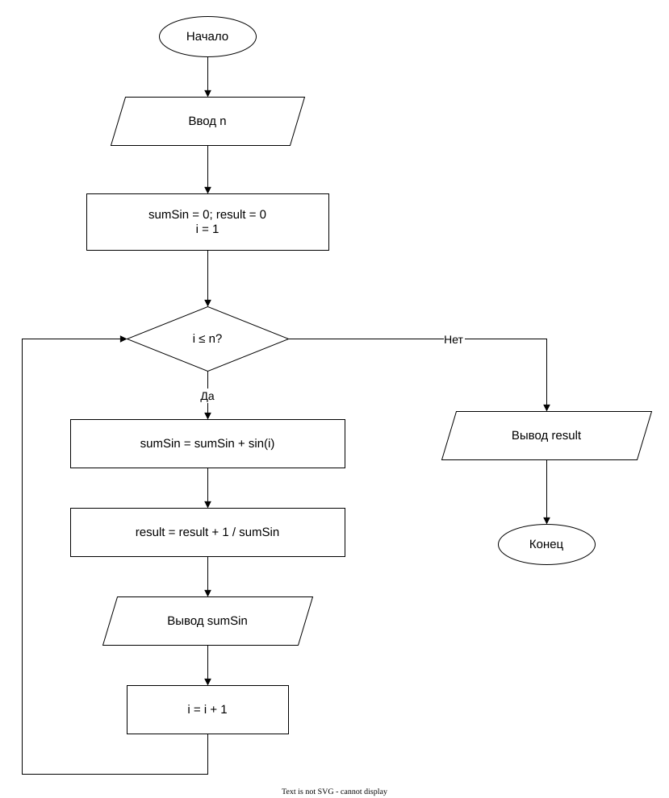

# Практическая работа 8. Цикл с параметрами
# Индивидуальное задание

## Вариант 15

### Блок-схема алгоритма

[Открыть блок-схему в draw.io](https://app.diagrams.net/?lang=ru#Uhttps%3A%2F%2Fraw.githubusercontent.com%2FDregMenlion%2Flab-8%2Fmaster%2Fflowchart.drawio)

# Информация о разработчике

**Трофимовский Артём**  
Группа: **бОТИ-261**
